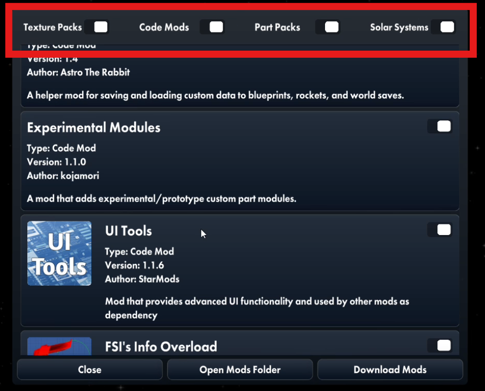
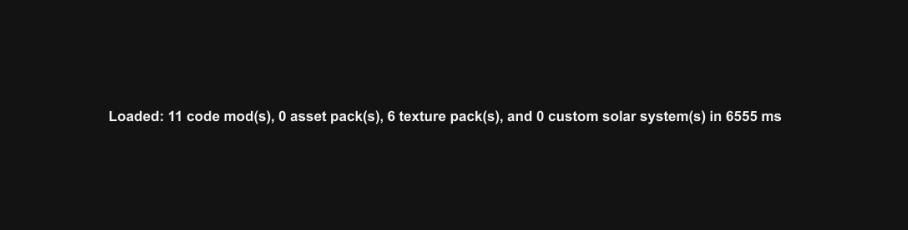
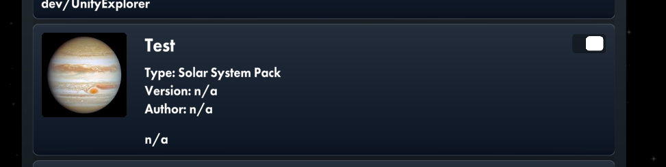

# Better Mod Menu

A code mod for the video game Spaceflight Simulator (SFS) that improves the in-game mod menu.
BetterModMenu 是一个非官方、开源、由社区驱动的《Spaceflight Simulator》（SFS）模组菜单优化项目。

 

<u>Disclaimer</u>

**This mod includes all functionality from the [PlanetPackIcons](https://github.com/kojamori/PlanetPackIcons/) Mod, and hence you should uninstall PlanetPackIcons to avoid any conflicts with this mod.**

**This mod includes all functionality (including enhanced reports) that the [Better Mod Loading](https://github.com/aaaa111ssf/SFS-BetterModLoading) Mod provides, and hence you should uninstall Better Mod Loading to avoid any conflicts with this mod.**

## Features
- Filter mods by type (code mod, asset pack, texture pack, custom solar system)
  - filter settings are saved to disk

- Detailed report when mods finished loading, with number of loaded mods for each type

- Requests confirmation to enter world/build scene if you try to enter before all mods are loaded

- Planet pack icons
  - Simply add a new `"icon"` field to your ImportSettings.txt, and put an image file in the same folder as ImportSettings.txt and reference it in the file, including the extension. 

## Future Roadmap
- ability to delete mods in-game
- reload non-code mods in-game
- auto-updatable mods
- detailed individual mod view window
  - view code mod dependencies, etc
- browse online list of mods from in-game and install them

## Requirements and Dependencies
- SFS (PC Version)
  - v1.6.00.16 and newer

## Installation

[Code Mod Installation Guide | SFS Modding Guide](https://kojamori.github.io/SFS-Modding-Guide/getting-started/installation/code-mods)

## Social Media

### Forum Post

https://sfsforum.com/index.php?threads/bettermodmenu-filter-mods-by-type-and-more.20179/

### SFS Modding Guide
https://kojamori.github.io/SFS-Modding-Guide/

### Discord

[Join the discord server here!](https://discord.gg/QHEmcehAe9)

# License

See the [LICENSE](LICENSE) file for details.
